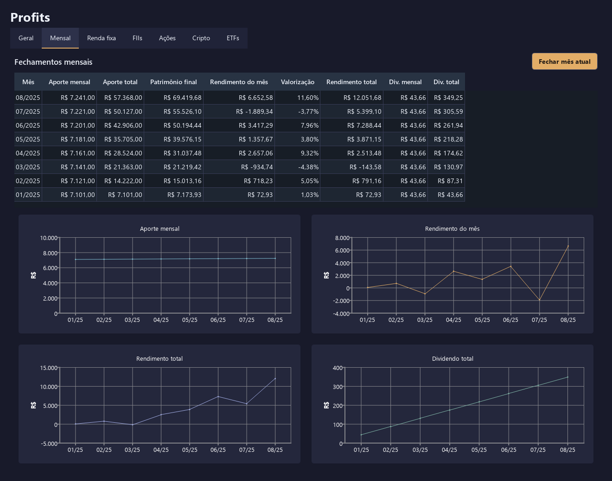
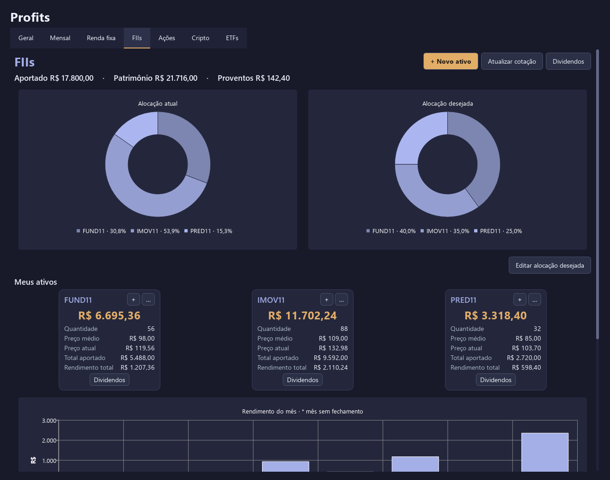
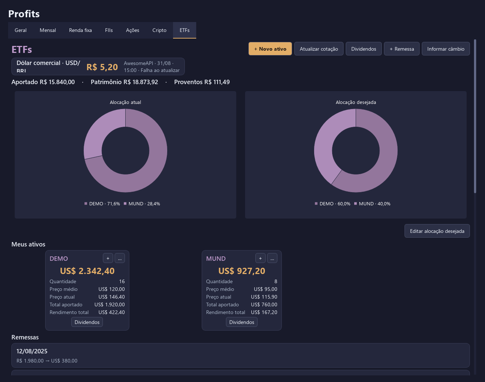
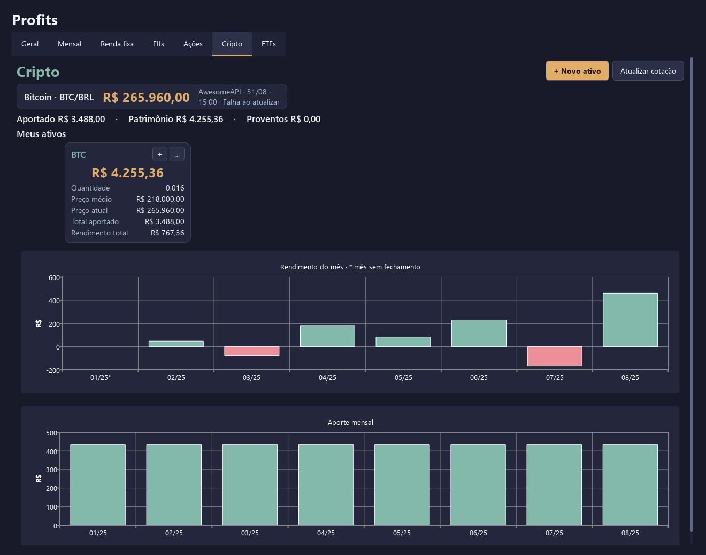
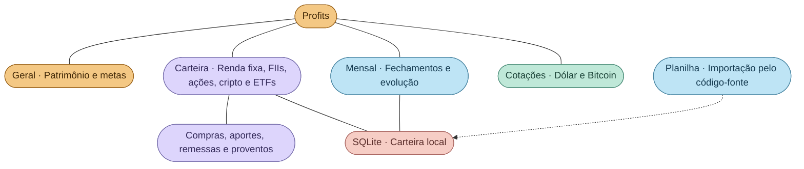

# Profits

  
  
  
  
  

  Aplicativo desktop de gestão de carteira com painel de patrimônio, evolução mensal
  e registro de compras e proventos.

  <a href="#-visão-geral">Visão geral</a> •
  <a href="#-funcionalidades">Funcionalidades</a> •
  <a href="#-capturas-do-sistema">Capturas do sistema</a> •
  <a href="#-como-usar">Como usar</a> •
  <a href="#-arquitetura">Arquitetura</a> •
  <a href="#-modelo-de-dados">Modelo de dados</a> •
  <a href="#-desenvolvimento">Desenvolvimento</a>

---

## 📌 Visão geral

O **Profits** transforma um fluxo de gestão de investimentos baseado em planilha em um aplicativo desktop.
A carteira reúne renda fixa, FIIs, ações, cripto e ETFs em abas próprias, com uma visão consolidada
da alocação e do crescimento mensal.

| ❌ Problema | 💡 Solução | ✅ Resultado |
|---|---|---|
| Um ativo novo exige ajustar fórmulas e gráficos. | **+ Novo ativo** cadastra o código e salva o primeiro aporte num único formulário. | O cartão aparece na aba e a posição passa a compor o patrimônio e a alocação. |
| O patrimônio e a evolução ficam distribuídos entre abas. | Roscas de carteira atual e desejada lado a lado, com metas editáveis. | A comparação usa as mesmas cores em ambas as roscas. |
| Aportes e dividendos ficam espalhados em tabelas. | Cartões de ativos, histórico por código e janela de dividendos com filtros. | Quantidade, cotação, valor aportado e rendimento ficam juntos. |
| ETFs envolvem aportes e compras em moedas diferentes. | Registro separado das remessas em reais e das compras em dólares. | O saldo em dólares entra na avaliação consolidada em reais. |

## 📊 Funcionalidades

- **Geral** mostra patrimônio, aporte acumulado, valorização e proventos. As fatias exibem o percentual e o valor ao passar o mouse.
- **Mensal** reúne a tabela de fechamentos e quatro gráficos de linha para aporte mensal, rendimento do mês, rendimento total e dividendo total.
- **FIIs, ações e ETFs** comparam a alocação atual e a desejada em roscas lado a lado, com metas editáveis por ativo. A janela de dividendos mostra totais, gráfico mensal e pagamentos por data.
- **Abas de investimento** exibem os gráficos de aporte e rendimento no fim da página. Rendimentos negativos têm cor própria e os valores aparecem ao passar o mouse. Em ETFs, a série de aportes mostra as remessas em reais.
- **ETFs e Cripto** consultam automaticamente o dólar comercial e o Bitcoin em reais a cada 30 segundos. Os painéis mostram o horário da fonte. As cotações usadas para avaliar a carteira são informadas na interface. [AwesomeAPI](https://docs.awesomeapi.com.br/api-de-moedas)
- **Cartões** mostram os dados da posição. Use **+** para acrescentar um aporte e **…** para consultar o histórico.
- **Renda fixa** registra aportes e usa o saldo informado pelo usuário para avaliar o patrimônio.
- **Tema Índigo e Âmbar** usa âmbar no Geral, azul glacial em renda fixa, lavanda em FIIs, coral em ações, jade em cripto e malva em ETFs.

## 🖼️ Capturas do sistema

Os saldos, ativos de exemplo, lançamentos e cotações das capturas são fictícios.

| Geral · Visão consolidada | Mensal · Fechamentos |
|---|---|
|  |  |

| FIIs · Alocação atual e desejada | FIIs · Aporte e rendimento |
|---|---|
|  |  |

| ETFs · Painel do dólar | Cripto · Painel do Bitcoin |
|---|---|
|  |  |

## 🚀 Como usar

1. Baixe o [Profits.exe](https://github.com/jcesarmph-ui/Profits/raw/refs/heads/main/downloads/Profits.exe) e abra no Windows de 64 bits. O executável abre maximizado e pode ser copiado para a Área de Trabalho. Para executar a partir do código-fonte, use **Abrir Profits.bat** com Python instalado.
2. Na aba da classe, use **+ Novo ativo** para registrar o código, a data, a quantidade, o total pago e a cotação atual por unidade. Informe compras de ETFs em dólares.
3. No **Geral**, preencha os percentuais desejados e salve quando somarem 100%.
4. Na aba **Mensal**, salve o fechamento ao final do mês com os saldos e cotações atualizados.

O executável de distribuição inicia com uma carteira vazia e salva os registros em `%LOCALAPPDATA%\Profits`. Na versão executada a partir do código-fonte, uma planilha **Profits.xlsx** no formato original pode preencher uma carteira vazia ou acrescentar fechamentos históricos por classe. A janela **Dados de origem** permite consultar os valores importados, incluindo campos auxiliares.

Como o fechamento mensal funciona

O fechamento guarda os totais da carteira para o mês. O rendimento acumulado é a diferença entre
o patrimônio e o aporte acumulado. O rendimento do mês é a variação desse resultado desde o fechamento
anterior. Os proventos têm colunas próprias.

As cotações iniciais vêm dos valores salvos na planilha e podem ser atualizadas manualmente na interface.

## 🧩 Arquitetura

| Tecnologia | Aplicação no projeto |
|---|---|
| Python | Operações da carteira, cálculos e importação. |
| PySide6 e Qt Charts | Interface desktop, formulários, tabelas e gráficos. |
| SQLite | Armazenamento local dos registros e fechamentos. |
| openpyxl | Leitura da planilha na importação inicial. |

## 🗃️ Modelo de dados

| Registro | Informações guardadas |
|---|---|
| Compras | Classe, data, ativo, quantidade, preço unitário e valor pago. |
| Aportes e remessas | Classe, data, montante em reais e dólares recebidos, quando aplicável. |
| Proventos | Classe, data, ativo e valor recebido. |
| Cotações e parâmetros | Último preço informado por ativo, câmbio e saldo de renda fixa. |
| Fechamentos | Totais mensais de aportes, patrimônio, rendimento e proventos. |
| Metas | Percentual desejado por classe e por ativo em FIIs, ações e ETFs. |
| Dados de origem | Valores da planilha local identificados por aba e célula. |

## 🛠️ Desenvolvimento

- [x] Painel geral e abas por classe de ativo.
- [x] Registro de compras, aportes, remessas e proventos.
- [x] Importação inicial e fechamento mensal.
- [x] Consulta automática do dólar e do Bitcoin em reais.
- [x] Executável para Windows com ícone da moeda e abertura maximizada.

Estrutura do repositório

| Arquivo | Responsabilidade |
|---|---|
| `app.py` | Janela, formulários, tabelas e gráficos. |
| `carteira.py` | Armazenamento, importação e cálculos da carteira. |
| `requirements.txt` | Dependências do aplicativo. |
| `assets/moeda.png` | Ícone da moeda com fundo transparente. |
| `docs/imagens/` | Capturas da interface com dados fictícios. |

A planilha e o banco da carteira ficam no computador do usuário e são ignorados pelo Git.

**O Profits reúne lançamentos, posições e fechamentos mensais em uma única interface.**
