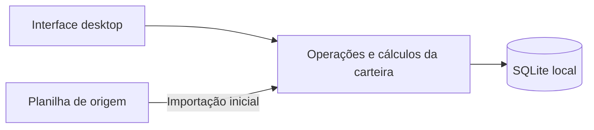

# Profits

  
  
  
  
  

  Aplicativo desktop de gestão de carteira com painel de patrimônio, evolução mensal
  e registro de compras e proventos.

  <a href="#-visão-geral">Visão geral</a> •
  <a href="#-funcionalidades">Funcionalidades</a> •
  <a href="#-arquitetura">Arquitetura</a> •
  <a href="#-modelo-de-dados">Modelo de dados</a> •
  <a href="#-desenvolvimento">Desenvolvimento</a>

---

## 📌 Visão geral

O **Profits** transforma um fluxo de gestão de investimentos baseado em planilha em um aplicativo desktop.
A carteira reúne renda fixa, FIIs, ações, cripto e ETFs em abas próprias, com uma visão consolidada
da alocação e do crescimento mensal.

| ❌ Problema | 💡 Solução | ✅ Resultado |
|---|---|---|
| Cada compra exige uma nova linha e ajustes em quadros auxiliares. | Formulário **+ Compra** para ativos existentes e novos. | Posição e preço médio são calculados pelos lançamentos. |
| O patrimônio e a evolução ficam distribuídos entre abas. | Painel geral e aba de fechamentos mensais. | Alocação por classe e série histórica ficam disponíveis no aplicativo. |
| ETFs envolvem aportes e compras em moedas diferentes. | Registro separado das remessas em reais e das compras em dólares. | O saldo em dólares entra na avaliação consolidada em reais. |

## 📊 Funcionalidades

- **Geral** mostra patrimônio, aporte acumulado, valorização e proventos, com gráficos de alocação e evolução mensal.
- **Mensal** reúne os nove campos do fechamento, incluindo patrimônio final, rendimento e dividendos.
- **FIIs, ações, cripto e ETFs** têm registro de compras, posição por ativo, preço médio e cotação.
- **Renda fixa** registra aportes e usa o saldo informado pelo usuário para avaliar o patrimônio.
- **Importação inicial** traz os lançamentos e fechamentos da planilha no formato Profits para o armazenamento local.

Como o fechamento mensal funciona

O fechamento guarda os totais da carteira para o mês. O rendimento acumulado é a diferença entre
o patrimônio e o aporte acumulado. O rendimento do mês é a variação desse resultado desde o fechamento
anterior. Os proventos têm colunas próprias.

As cotações iniciais vêm dos valores salvos na planilha e podem ser atualizadas manualmente na interface.

## 🧩 Arquitetura

| Tecnologia | Aplicação no projeto |
|---|---|
| Python | Operações da carteira, cálculos e importação. |
| PySide6 e Qt Charts | Interface desktop, formulários, tabelas e gráficos. |
| SQLite | Armazenamento local dos registros e fechamentos. |
| openpyxl | Leitura da planilha na importação inicial. |

## 🗃️ Modelo de dados

| Registro | Informações guardadas |
|---|---|
| Compras | Classe, data, ativo, quantidade, preço unitário e valor pago. |
| Aportes e remessas | Classe, data, montante em reais e dólares recebidos, quando aplicável. |
| Proventos | Classe, data, ativo e valor recebido. |
| Cotações e parâmetros | Último preço informado por ativo, câmbio e saldo de renda fixa. |
| Fechamentos | Totais mensais de aportes, patrimônio, rendimento e proventos. |

## 🛠️ Desenvolvimento

- [x] Painel geral e abas por classe de ativo.
- [x] Registro de compras, aportes, remessas e proventos.
- [x] Importação inicial e fechamento mensal.
- [ ] Integração com fontes de cotação para atualização automática.

Estrutura do repositório

| Arquivo | Responsabilidade |
|---|---|
| `app.py` | Janela, formulários, tabelas e gráficos. |
| `carteira.py` | Armazenamento, importação e cálculos da carteira. |
| `requirements.txt` | Dependências do aplicativo. |

A planilha e o banco da carteira ficam no computador do usuário e são ignorados pelo Git.

**O Profits reúne lançamentos, posições e fechamentos mensais em uma única interface.**
