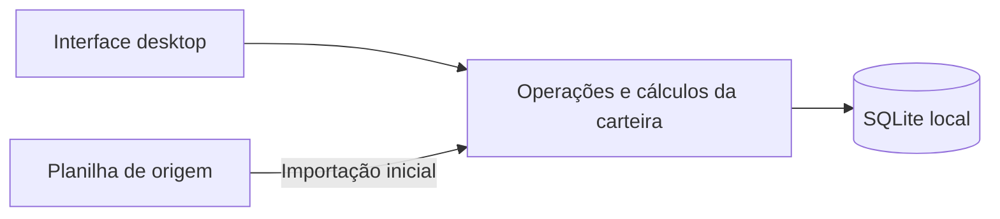

# Profits

  
  
  
  
  

  Aplicativo desktop de gestão de carteira com painel de patrimônio, evolução mensal
  e registro de compras e proventos.

  <a href="#-visão-geral">Visão geral</a> •
  <a href="#-funcionalidades">Funcionalidades</a> •
  <a href="#-como-usar">Como usar</a> •
  <a href="#-arquitetura">Arquitetura</a> •
  <a href="#-modelo-de-dados">Modelo de dados</a> •
  <a href="#-desenvolvimento">Desenvolvimento</a>

---

## 📌 Visão geral

O **Profits** transforma um fluxo de gestão de investimentos baseado em planilha em um aplicativo desktop.
A carteira reúne renda fixa, FIIs, ações, cripto e ETFs em abas próprias, com uma visão consolidada
da alocação e do crescimento mensal.

| ❌ Problema | 💡 Solução | ✅ Resultado |
|---|---|---|
| Um ativo novo exige ajustar fórmulas e gráficos. | **+ Novo ativo** cadastra o código e salva o primeiro aporte num único formulário. | O cartão aparece na aba e a posição passa a compor o patrimônio e a alocação. |
| O patrimônio e a evolução ficam distribuídos entre abas. | Roscas de carteira atual e desejada lado a lado, com metas editáveis. | A comparação usa as mesmas cores em ambas as roscas. |
| Aportes e dividendos ficam espalhados em tabelas. | Cartões de ativos, histórico por código e janela de dividendos com filtros. | Quantidade, cotação, valor aportado e rendimento ficam juntos. |
| ETFs envolvem aportes e compras em moedas diferentes. | Registro separado das remessas em reais e das compras em dólares. | O saldo em dólares entra na avaliação consolidada em reais. |

## 📊 Funcionalidades

- **Geral** mostra patrimônio, aporte acumulado, valorização e proventos. As fatias exibem o percentual e o valor ao passar o mouse.
- **Mensal** reúne os nove campos do fechamento, incluindo patrimônio final, rendimento e dividendos.
- **FIIs, ações e ETFs** têm roscas de distribuição por ativo e uma janela de dividendos com totais, gráfico mensal e pagamentos por data.
- **Abas de investimento** mostram barras de rendimento do mês e aporte mensal. O rendimento depende dos fechamentos disponíveis. Em ETFs, o aporte mensal em reais representa as remessas.
- **Cartões** mostram os dados da posição. Use **+** para acrescentar um aporte e **…** para consultar o histórico.
- **Renda fixa** registra aportes e usa o saldo informado pelo usuário para avaliar o patrimônio.
- **Tema Índigo e Âmbar** usa âmbar no Geral, azul glacial em renda fixa, lavanda em FIIs, coral em ações, jade em cripto e malva em ETFs.

## 🚀 Como usar

1. Abra **Abrir Profits.bat** no Windows com Python instalado.
2. Na aba da classe, use **+ Novo ativo** para registrar o código, a data, a quantidade, o total pago e a cotação atual por unidade. Informe compras de ETFs em dólares.
3. No **Geral**, preencha os percentuais desejados e salve quando somarem 100%.
4. Na aba **Mensal**, salve o fechamento ao final do mês com os saldos e cotações atualizados.

Se uma planilha **Profits.xlsx** no formato original estiver na pasta do aplicativo, o Profits carrega os lançamentos ao iniciar uma carteira vazia. Em uma carteira existente, acrescenta os fechamentos históricos por classe e preserva os lançamentos salvos. A janela **Dados de origem** permite consultar os valores das células, incluindo campos auxiliares.

Como o fechamento mensal funciona

O fechamento guarda os totais da carteira para o mês. O rendimento acumulado é a diferença entre
o patrimônio e o aporte acumulado. O rendimento do mês é a variação desse resultado desde o fechamento
anterior. Os proventos têm colunas próprias.

As cotações iniciais vêm dos valores salvos na planilha e podem ser atualizadas manualmente na interface.

## 🧩 Arquitetura

| Tecnologia | Aplicação no projeto |
|---|---|
| Python | Operações da carteira, cálculos e importação. |
| PySide6 e Qt Charts | Interface desktop, formulários, tabelas e gráficos. |
| SQLite | Armazenamento local dos registros e fechamentos. |
| openpyxl | Leitura da planilha na importação inicial. |

## 🗃️ Modelo de dados

| Registro | Informações guardadas |
|---|---|
| Compras | Classe, data, ativo, quantidade, preço unitário e valor pago. |
| Aportes e remessas | Classe, data, montante em reais e dólares recebidos, quando aplicável. |
| Proventos | Classe, data, ativo e valor recebido. |
| Cotações e parâmetros | Último preço informado por ativo, câmbio e saldo de renda fixa. |
| Fechamentos | Totais mensais de aportes, patrimônio, rendimento e proventos. |
| Metas | Percentual desejado para cada classe. |
| Dados de origem | Valores da planilha local identificados por aba e célula. |

## 🛠️ Desenvolvimento

- [x] Painel geral e abas por classe de ativo.
- [x] Registro de compras, aportes, remessas e proventos.
- [x] Importação inicial e fechamento mensal.
- [ ] Integração com fontes de cotação para atualização automática.

Estrutura do repositório

| Arquivo | Responsabilidade |
|---|---|
| `app.py` | Janela, formulários, tabelas e gráficos. |
| `carteira.py` | Armazenamento, importação e cálculos da carteira. |
| `requirements.txt` | Dependências do aplicativo. |

A planilha e o banco da carteira ficam no computador do usuário e são ignorados pelo Git.

**O Profits reúne lançamentos, posições e fechamentos mensais em uma única interface.**
