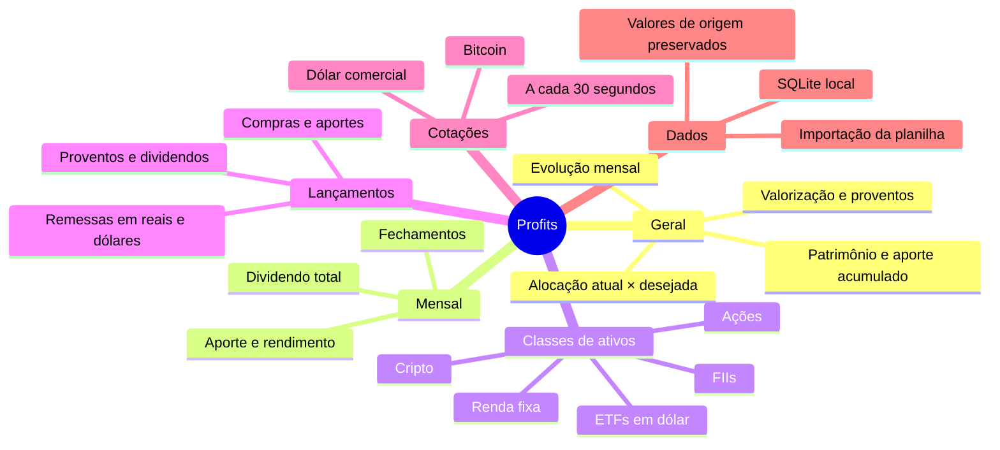
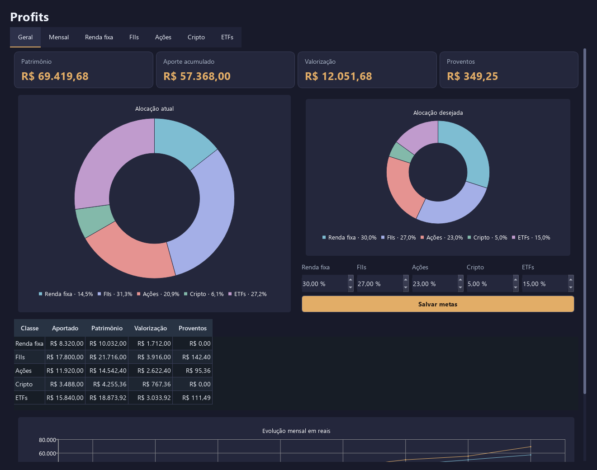
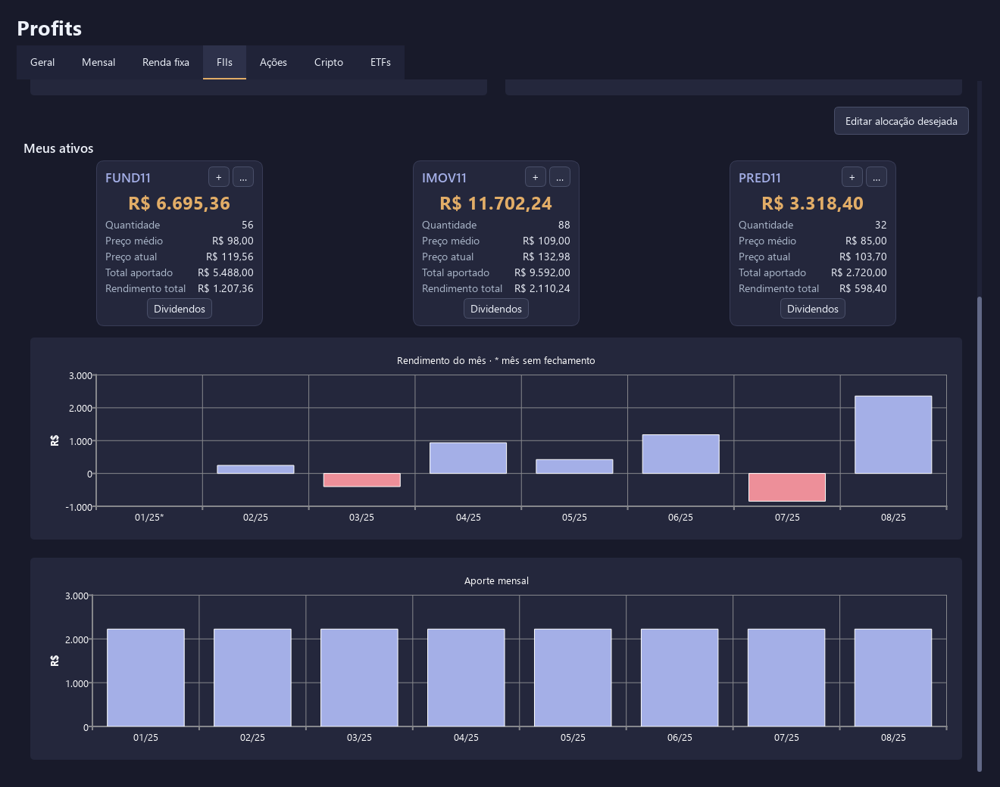
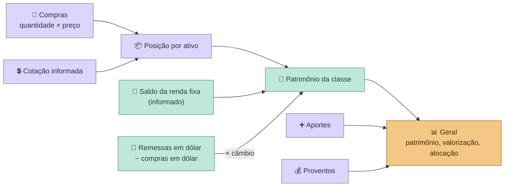
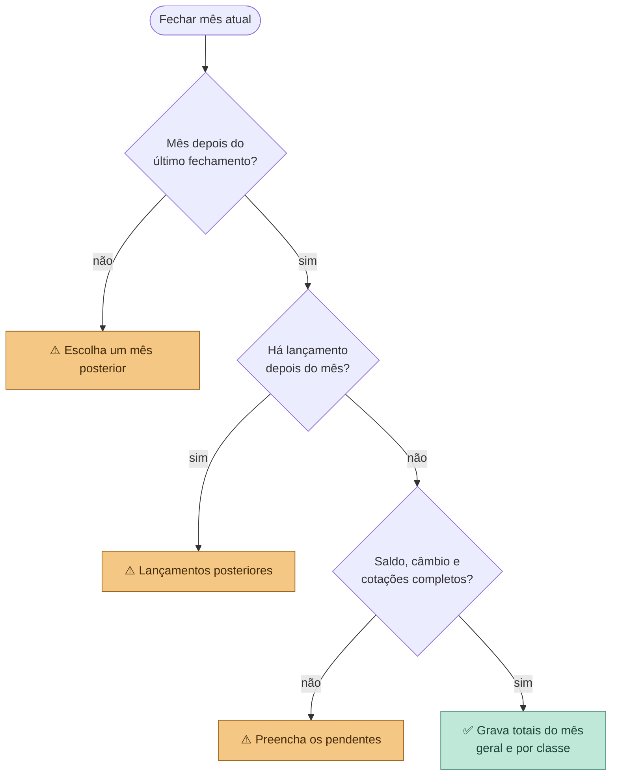
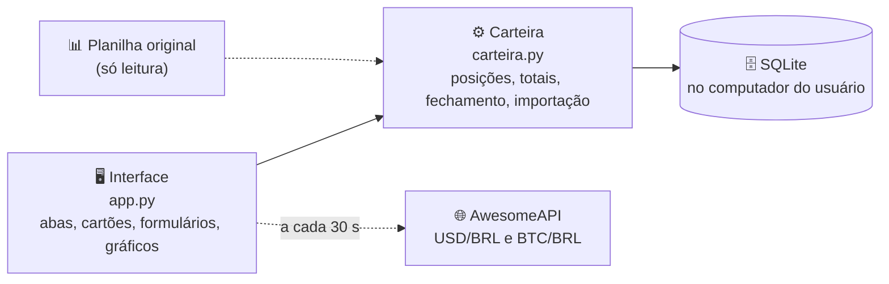
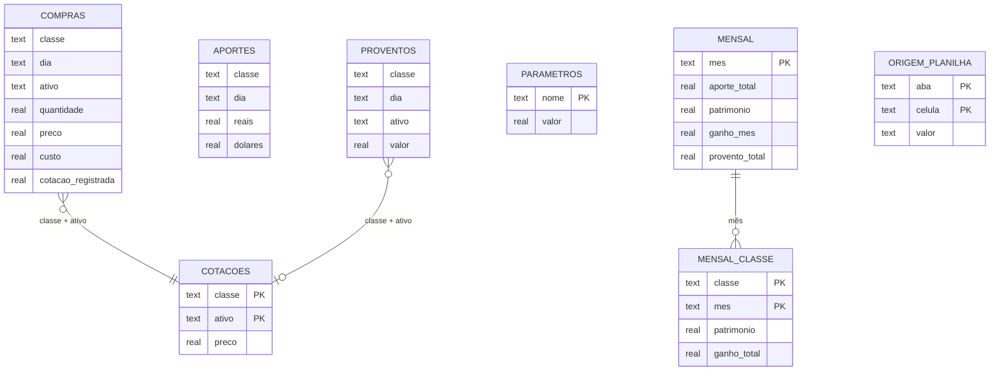

# Profits

<p align="center">
  
  
  
  
  
</p>
<p align="center">
  
  
  
  
  
</p>
<p align="center">
  
  
  
  
  
</p>

<p align="center">
  Aplicativo desktop de gestão de carteira com painel de patrimônio, evolução mensal
  e registro de compras e proventos: renda fixa, FIIs, ações, cripto e ETFs numa só janela,
  com alocação atual × desejada, fechamento mensal e cotação do dólar e do Bitcoin em tempo real.
</p>

<p align="center">
  <a href="#-visão-geral">Visão geral</a> •
  <a href="#-em-números">Em números</a> •
  <a href="#-telas">Telas</a> •
  <a href="#-funcionalidades">Funcionalidades</a> •
  <a href="#-como-as-contas-são-feitas">Como funciona</a> •
  <a href="#-arquitetura">Arquitetura</a> •
  <a href="#️-modelo-de-dados">Modelo de dados</a> •
  <a href="#️-como-foi-desenvolvido">Desenvolvimento</a> •
  <a href="#-estrutura-do-repositório">Estrutura</a>
</p>

---

## 📌 Visão geral

O **Profits** transforma um fluxo de gestão de investimentos baseado em planilha em um aplicativo desktop.
A carteira reúne renda fixa, FIIs, ações, cripto e ETFs em abas próprias, com uma visão consolidada
da alocação e do crescimento mensal.

| ❌ Problema | 💡 Solução | ✅ Resultado |
|---|---|---|
| Um ativo novo exige ajustar fórmulas e gráficos. | **+ Novo ativo** cadastra o código e salva o primeiro aporte num único formulário. | O cartão aparece na aba e a posição passa a compor o patrimônio e a alocação. |
| O patrimônio e a evolução ficam distribuídos entre abas. | Roscas de carteira atual e desejada lado a lado, com metas editáveis. | A comparação usa as mesmas cores em ambas as roscas. |
| Aportes e dividendos ficam espalhados em tabelas. | Cartões de ativos, histórico por código e janela de dividendos com filtros. | Quantidade, cotação, valor aportado e rendimento ficam juntos. |
| ETFs envolvem aportes e compras em moedas diferentes. | Registro separado das remessas em reais e das compras em dólares. | O saldo em dólares entra na avaliação consolidada em reais. |
| Cotação do dólar e do Bitcoin procurada à mão em outro site. | Consulta automática a cada **30 segundos** (AwesomeAPI). | Valor e horário da fonte sempre à vista nas abas ETFs e Cripto. |
| Fechamento do mês copiado à mão, sujeito a erro. | **Fechar mês atual** grava os totais com conferências antes de salvar. | Nada é fechado com cotação pendente, fora de ordem ou com lançamento posterior. |



### 🎯 Objetivos

| | Objetivo |
|---|---|
| 💼 | Reunir todos os investimentos numa única janela, por classe de ativo. |
| 🎯 | Comparar a alocação atual com a desejada e enxergar onde aportar. |
| 📈 | Acompanhar a evolução mensal do patrimônio, do rendimento e dos dividendos. |
| 💱 | Tratar ativos em dólar sem perder a visão consolidada em reais. |
| 📉 | Sair da planilha cheia de fórmulas sem perder o histórico dela. |

## 📊 Em números

| | Número | O que significa |
|---|---|---|
| 🐍 | **~1.100 linhas** de Python em **2 arquivos** | Interface (`app.py`) separada das contas e do banco (`carteira.py`). |
| 🗂️ | **7 abas** | Geral, Mensal e uma por classe: renda fixa, FIIs, ações, cripto e ETFs. |
| 🗄️ | **9 tabelas** no SQLite | Compras, aportes, proventos, cotações, parâmetros, fechamentos (geral e por classe), metas e dados de origem. |
| 📊 | **4 tipos de gráfico** | Rosca, linhas, barras e barras com valores ao passar o mouse (Qt Charts). |
| ⏱️ | **30 segundos** | Intervalo da consulta automática do dólar e do Bitcoin. |
| 📸 | **6 telas** documentadas | Todas com dados fictícios. |

## 📸 Telas

Os saldos, ativos de exemplo, lançamentos e cotações das capturas são fictícios.

<p align="center">
  <br/>
  <i>Geral · Visão consolidada: patrimônio, alocação atual × desejada e metas por classe</i>
</p>

<p align="center">
  <br/>
  <i>Mensal · Fechamentos e quatro gráficos de evolução</i>
</p>

| FIIs · Alocação atual e desejada | FIIs · Aporte e rendimento |
|---|---|
|  |  |
| *Cartões dos ativos com preço médio e rendimento* | *Barras do rendimento e do aporte de cada mês* |

| ETFs · Painel do dólar | Cripto · Painel do Bitcoin |
|---|---|
|  |  |
| *Dólar comercial consultado sozinho, com o horário da fonte* | *Bitcoin em reais, atualizado a cada 30 segundos* |

## ✨ Funcionalidades

- **Geral** mostra patrimônio, aporte acumulado, valorização e proventos. As fatias exibem o percentual e o valor ao passar o mouse.
- **Mensal** reúne a tabela de fechamentos e quatro gráficos de linha para aporte mensal, rendimento do mês, rendimento total e dividendo total.
- **FIIs, ações e ETFs** comparam a alocação atual e a desejada em roscas lado a lado, com metas editáveis por ativo. A janela de dividendos mostra totais, gráfico mensal e pagamentos por data.
- **Abas de investimento** exibem os gráficos de aporte e rendimento no fim da página. Rendimentos negativos têm cor própria e os valores aparecem ao passar o mouse. Em ETFs, a série de aportes mostra as remessas em reais.
- **ETFs e Cripto** consultam automaticamente o dólar comercial e o Bitcoin em reais a cada 30 segundos. Os painéis mostram o horário da fonte. As cotações usadas para avaliar a carteira são informadas na interface. [AwesomeAPI](https://docs.awesomeapi.com.br/api-de-moedas)
- **Cartões** mostram os dados da posição. Use **+** para acrescentar um aporte e **…** para consultar o histórico.
- **Renda fixa** registra aportes e usa o saldo informado pelo usuário para avaliar o patrimônio.
- **Tema Índigo e Âmbar** usa âmbar no Geral, azul glacial em renda fixa, lavanda em FIIs, coral em ações, jade em cripto e malva em ETFs.

<details>
<summary><b>🔎 Mais detalhes de cada parte</b></summary>

| Parte | O que faz |
|---|---|
| 🃏 **Cartão do ativo** | Patrimônio atual em destaque, quantidade, preço médio, preço atual, total aportado e rendimento total. |
| 📜 **Informações completas** | Histórico de aportes do ativo: data, valor, unidades, preço pago e a cotação informada em cada aporte. |
| 💰 **Janela de dividendos** | Filtro por ativo e por período (últimos 12 meses ou todo o histórico), total recebido, último pagamento, média mensal, gráfico por mês e lista de pagamentos. |
| 🎯 **Metas** | Percentual desejado por classe (no Geral) e por ativo (FIIs, ações e ETFs); a soma precisa dar 100 %. |
| 💱 **Remessas** | Em ETFs, cada remessa guarda o valor pago em reais e os dólares recebidos depois das taxas. |
| 📥 **Dados de origem** | Janela com os valores preservados da planilha original, aba por aba e célula por célula. |
| 🛡️ **Conferências** | Ativo repetido, valores zerados, metas que não somam 100 % e câmbio inválido são recusados com uma mensagem clara. |

</details>

## 🧠 Como as contas são feitas

O patrimônio de cada classe é calculado em tempo real, a partir dos lançamentos; o fechamento mensal
só grava o retrato do mês quando todas as informações estão completas.





> [!NOTE]
> Enquanto falta alguma cotação ou o saldo da renda fixa, o Geral avisa quais classes estão
> pendentes e a alocação usa só as classes com saldo conhecido.

## 🧩 Arquitetura


<details>
<summary><b>🧱 Camadas</b></summary>



A planilha e o banco ficam só no computador do usuário e nunca vão para o repositório.

</details>

| Tecnologia | Aplicação no projeto |
|---|---|
| Python | Operações da carteira, cálculos e importação. |
| PySide6 e Qt Charts | Interface desktop, formulários, tabelas e gráficos. |
| SQLite | Armazenamento local dos registros e fechamentos. |
| openpyxl | Leitura da planilha na importação inicial. |
| Qt Network + AwesomeAPI | Consulta do dólar comercial e do Bitcoin em reais, sem travar a janela. |
| PyInstaller | Versão para Windows com ícone da moeda e abertura maximizada. |
| Git e GitHub | Histórico do projeto e pull requests. |
| Codex (OpenAI) | IA usada como ferramenta de desenvolvimento, com as regras definidas manualmente. |

## 🗃️ Modelo de dados

| Registro | Informações guardadas |
|---|---|
| Compras | Classe, data, ativo, quantidade, preço unitário e valor pago. |
| Aportes e remessas | Classe, data, montante em reais e dólares recebidos, quando aplicável. |
| Proventos | Classe, data, ativo e valor recebido. |
| Cotações e parâmetros | Último preço informado por ativo, câmbio e saldo de renda fixa. |
| Fechamentos | Totais mensais de aportes, patrimônio, rendimento e proventos. |
| Metas | Percentual desejado por classe e por ativo em FIIs, ações e ETFs. |
| Dados de origem | Valores da planilha local identificados por aba e célula. |

<details>
<summary><b>🗄️ Diagrama das tabelas</b></summary>



As metas, o câmbio e o saldo da renda fixa ficam em `PARAMETROS` (nome → valor).

</details>

## 🛠️ Como foi desenvolvido

| Prática | Como foi aplicada |
|---|---|
| 🔀 **Pull requests** | A primeira versão foi feita num branch próprio e juntada por pull request. |
| 🧱 **Camadas separadas** | Contas e banco em `carteira.py`, sem depender da tela; a interface só mostra e coleta dados. |
| 🔒 **Dados protegidos** | Planilha, banco e executável ficam fora do Git; as fotos usam carteira fictícia. |
| 📥 **Migração fiel** | A planilha original só é lida, e as células sem campo próprio ficam guardadas para consulta. |
| 🤖 **IA como ferramenta** | Desenvolvimento com o Codex (OpenAI): as regras são definidas manualmente e cada etapa é revisada e aprovada. |

### 🗺️ Roteiro

- [x] Painel geral e abas por classe de ativo.
- [x] Registro de compras, aportes, remessas e proventos.
- [x] Importação inicial e fechamento mensal.
- [x] Consulta automática do dólar e do Bitcoin em reais.
- [x] Executável para Windows com ícone da moeda e abertura maximizada.

<details>
<summary><b>📅 História do projeto</b></summary>

| Etapa | O que mudou |
|---|---|
| 🌱 Primeira versão | Aplicativo desktop de gestão de carteira, com abas por classe e banco local (PR #1). |
| 🌍 Configuração regional | Números e datas no formato brasileiro desde a abertura. |
| 🎨 Painel renovado | Roscas de alocação atual × desejada, cartões de ativos e janela de dividendos. |
| 💱 Cotações e Windows | Dólar e Bitcoin automáticos e versão para Windows. |
| 📖 Portfólio | README completo com telas, arquitetura e modelo de dados. |

</details>

## 📁 Estrutura do repositório

```text
Profits/
├── app.py              # janela, abas, formulários, tabelas e gráficos
├── carteira.py         # banco, importação e cálculos da carteira
├── requirements.txt    # dependências
├── assets/moeda.png    # ícone da moeda
└── docs/imagens/       # telas com dados fictícios
```

<details>
<summary>Estrutura do repositório</summary>

| Arquivo | Responsabilidade |
|---|---|
| `app.py` | Janela, formulários, tabelas e gráficos. |
| `carteira.py` | Armazenamento, importação e cálculos da carteira. |
| `requirements.txt` | Dependências do aplicativo. |
| `assets/moeda.png` | Ícone da moeda com fundo transparente. |
| `docs/imagens/` | Capturas da interface com dados fictícios. |

A planilha e o banco da carteira ficam no computador do usuário e são ignorados pelo Git.

</details>

## 🏅 Competências demonstradas

| | Competência |
|---|---|
| 🐍 | Desenvolvimento de aplicações desktop em Python com PySide6. |
| 📊 | Visualização de dados financeiros com Qt Charts (roscas, linhas e barras interativas). |
| 🌐 | Consumo de API pública sem travar a interface (requisições assíncronas). |
| 🗃️ | Modelagem e persistência de dados em SQLite. |
| 📥 | Migração de dados de planilha legada, preservando a origem. |
| 💱 | Regras de negócio com várias moedas e consolidação em reais. |
| 🎨 | Identidade visual própria, com uma cor por classe de ativo. |
| 🤖 | Uso de IA (Codex) como ferramenta de desenvolvimento, com as regras sob controle manual. |

---

<p align="center">
  <b>O Profits reúne lançamentos, posições e fechamentos mensais em uma única interface.</b>
</p>
